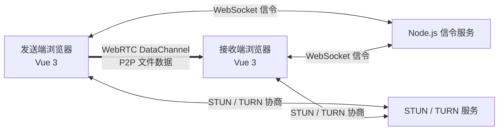

# CampusDrop

CampusDrop 是一个基于 WebRTC 的跨设备 P2P 文件传输系统，面向大学计算机网络课程设计。项目计划通过浏览器完成设备发现、信令协商和点对点文件传输，让用户在校园网或互联网环境中，无需依赖传统网盘或即时通信软件，也可以在不同设备之间直接发送文件。

> **当前状态：仓库初始化阶段。** 目前仅包含项目说明和 Git 忽略规则，尚未实现任何可运行功能，也不包含应用模板代码。

## 项目简介

CampusDrop 的核心目标是研究并实践 WebRTC 在实际文件传输场景中的应用。系统由 Web 前端、Node.js 信令服务和可选的 STUN/TURN 服务组成：信令服务只负责帮助设备建立连接，文件内容优先通过 WebRTC DataChannel 在设备之间直接传输。

与“先上传服务器、再下载”的传输方式相比，P2P 模式可以减少中转环节、降低服务器带宽压力，并为局域网或校园网内的设备直连提供更好的传输体验。

## 使用场景

- **课堂与实验室协作**：在同学的电脑、平板或手机之间快速交换实验数据、文档和演示文稿。
- **宿舍局域网互传**：同一校园网内的设备直接传输图片、视频和压缩包，减少对公网带宽的占用。
- **跨设备临时传输**：在不同操作系统、不同浏览器之间发送文件，无需安装额外客户端。
- **课程演示与实验**：观察 WebRTC 信令、ICE 协商、NAT 穿越和端到端数据传输过程。
- **隐私敏感文件传输**：在连接建立后，文件数据优先走端到端加密的 P2P 通道，而不是先持久化到业务服务器。

## 计划功能

以下功能为后续课程设计目标，当前均处于规划阶段：

- 创建或加入临时传输房间，通过房间码连接不同设备。
- 基于 WebSocket 的信令交换，包括房间管理、会话协商和连接状态同步。
- 使用 WebRTC DataChannel 进行浏览器之间的 P2P 数据传输。
- 支持多文件选择、队列传输和发送/接收进度展示。
- 传输前展示文件名、大小、类型等元数据，由接收方确认。
- 分块读取大文件，避免一次性将整个文件加载到内存。
- 处理 DataChannel 缓冲区背压，提升大文件传输稳定性。
- 支持取消传输、失败提示和基础断线状态反馈。
- 展示连接类型、传输速率和已传输数据量等诊断信息。
- 在无法建立直连时，预留 TURN 中继降级方案。
- 提供桌面端与移动端均可使用的响应式 Web 界面。

## 技术栈

| 层次 | 技术 | 计划用途 |
| --- | --- | --- |
| 前端 | Vue 3 | 构建传输房间、文件选择、进度与连接状态界面 |
| 前端构建 | Vite | 本地开发与生产构建 |
| 信令服务 | Node.js | 房间管理、WebSocket 消息转发和会话协调 |
| 信令通信 | WebSocket | 交换 SDP、ICE Candidate 与房间事件 |
| P2P 传输 | WebRTC | 建立浏览器之间的连接并通过 DataChannel 传输文件 |
| 网络辅助 | STUN / TURN | 公网地址发现、NAT 穿越及无法直连时的中继降级 |

> 当前仓库尚未引入上述依赖或脚手架。技术栈将在功能开发阶段按实际需求落地。

## 系统架构

### 组件职责

1. **Web 客户端**
   - 创建、加入或离开传输房间。
   - 采集并交换 WebRTC 会话描述与网络候选地址。
   - 读取文件、分块发送、接收重组并校验传输结果。
   - 展示连接状态、传输进度、速率和错误信息。

2. **Node.js 信令服务**
   - 维护短期房间和参与者关系。
   - 转发 SDP Offer/Answer 和 ICE Candidate。
   - 通知设备加入、离开和连接状态变化。
   - 不保存文件内容，不作为文件数据的数据面通道。

3. **STUN / TURN 服务**
   - STUN 帮助设备发现公网映射地址。
   - TURN 在 NAT、防火墙或网络策略导致直连失败时提供中继。
   - 中继会增加服务器带宽和延迟，因此仅作为降级方案。

### 预期连接流程

1. 发送端和接收端分别通过 WebSocket 连接到信令服务，并加入同一房间。
2. 发起端创建 `RTCPeerConnection`，生成 Offer 并通过信令服务发送给接收端。
3. 接收端返回 Answer，双方交换 ICE Candidate。
4. ICE 协商选择可用的网络路径，建立 WebRTC Peer Connection。
5. 双方打开 DataChannel，发送端按约定分块发送文件元数据和内容。
6. 接收端重组文件，完成后触发浏览器下载，并向发送端反馈结果。
7. 任一设备离开房间后，信令服务清理会话并通知对端。

## 涉及的计算机网络知识

- **网络分层模型**：理解应用层信令、传输层连接、TLS/DTLS 安全通道和底层 IP 路由之间的关系。
- **HTTP/HTTPS 与 WebSocket**：使用 HTTPS 加载页面，通过 WebSocket 建立全双工信令通道。
- **WebRTC 与 SDP**：利用 Session Description Protocol 描述媒体/数据通道能力、编解码参数和连接角色。
- **ICE、STUN 与 TURN**：学习候选地址收集、连通性检查、NAT 穿越和 TURN 中继机制。
- **NAT 与防火墙**：分析私网地址、端口映射、对称 NAT 和校园网访问策略对 P2P 连接的影响。
- **TCP 与 UDP**：理解信令通常依赖可靠的 WebSocket/TCP，而 WebRTC 底层使用 UDP，并通过协议机制提供可靠性。
- **DTLS 与端到端加密**：WebRTC DataChannel 使用 DTLS 保护传输内容，避免文件以明文经过网络。
- **应用层分块与重组**：根据 DataChannel 消息大小和缓冲区状态设计文件分片、序号、确认与重组机制。
- **流量控制与背压**：根据 `bufferedAmount` 调整发送节奏，避免内存占用过高或连接拥塞。
- **带宽、延迟与吞吐量**：观察网络条件对传输速率、完成时间和用户体验的影响。
- **连接状态管理**：处理候选失败、ICE 重连、设备离线、超时和资源释放等异常场景。
- **安全边界**：信令服务需要限制房间访问，避免任意用户加入传输会话；文件名和元数据也需要进行校验。

## 课程设计现阶段范围

当前阶段只完成项目立项、仓库初始化和技术方案说明。后续开发按以下顺序推进：

1. 完成 Vue 3 前端与 Node.js 信令服务的最小可运行骨架。
2. 实现房间创建、加入和 WebSocket 信令交换。
3. 建立 WebRTC DataChannel，先完成小文本消息互通。
4. 实现文件元数据协商、分块发送、进度反馈和下载。
5. 增加背压处理、取消传输、异常恢复与连接诊断。
6. 在校园网、不同 NAT 网络和 TURN 环境下进行测试与记录。

## 开发与运行状态

当前没有可运行的安装、启动或测试命令。项目功能会在后续提交中逐步实现，README 也将随实现进度同步更新。

## 项目信息

- **项目名称**：CampusDrop
- **项目类型**：大学计算机网络课程设计
- **核心方向**：WebRTC P2P 文件传输
- **仓库状态**：初始化完成，功能待开发
